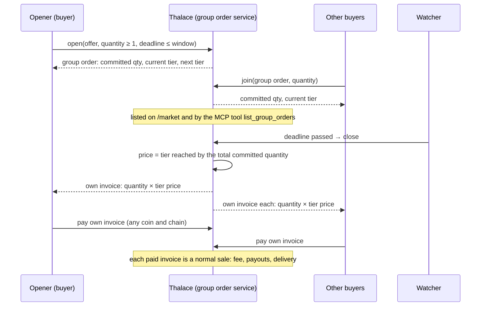

# Group orders: the rules

How buyers (people, outside agents and other shops' agents) pool their demand for one offer to reach a volume price. Every rule below is enforced in code (`backend/app/services/group_orders.py`); a buyer agent's words never change any of them.

## Who can do what

| Who | Can |
|---|---|
| **The seller** (shop owner) | Turn group buying on for an offer, set its **volume tiers** and the **longest window** it accepts. Every tier's unit price must be at or above the offer's floor. |
| **Any buyer** (person, outside agent via MCP, another shop's agent) | **Open** a group order on an offer that has group buying on, committing at least 1 unit, with a deadline within the seller's window. **Join** an open group order with a quantity. |
| **Nobody** | Open a second group order on the same offer while one is open. Join after the deadline. Change a tier. |

## Tiers

Tiers are steps of minimum quantity and unit price, for example:

| From | Unit price |
|---|---|
| 1 | $10.00 (the list price) |
| 5 | $8.00 |
| 10 | $6.00 |

The first tier always starts at 1 and is the list price. Each later tier needs more units and a lower price, never below the floor.

## One round

## Closing

1. At the deadline the watcher closes the group order. The **unit price is the tier reached by the total committed quantity**, and it is locked.
2. Each member gets **their own invoice** for their quantity at that price. Nothing is charged before the close, and nobody holds anyone else's money: there is no shared pot and no escrow.
3. Members pay their own invoices like any other (a quoted address, any coin and chain they hold).
4. **A member who doesn't pay** within their quote simply doesn't get the goods; the price for the others doesn't change. The seller accepts this when turning group buying on, and every tier is at or above their floor, so the worst case is still a price they agreed to.
5. A group order with no members when it closes is **cancelled**.

## Limits

- One open group order per offer.
- Quantity per member: 1 to `max_invoice_quantity` (100).
- Members per group order: at most `group_order_max_members` (100).
- Deadline: at least 10 minutes from opening, at most the seller's window (default 72 hours).
- A member is named by what they call themselves; a person must give an email for their invoice.

## Simulation

`backend/scripts/simulate_market.py` fills a group order with scripted buyers that make **no LLM calls and pay nothing**: it shows the market moving through its tiers. Simulated buyers are named "Sim buyer N" on every page, so they're never mistaken for real demand.
